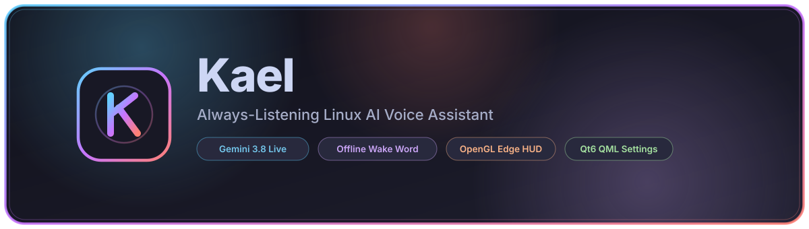
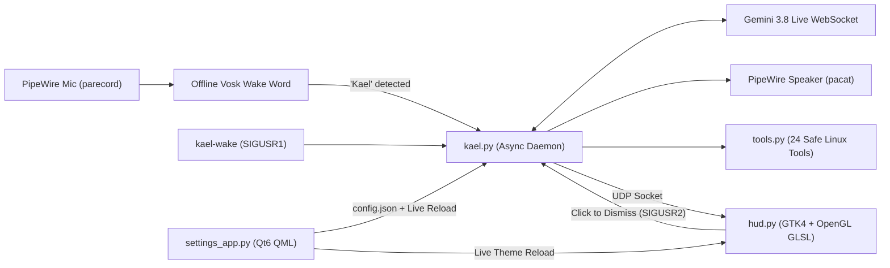

<p align="center">
  
</p>

<p align="center">
  <a href="https://github.com/BongooHi/kael/releases"></a>
  <a href="LICENSE"></a>
  
  
  
</p>

<p align="center">
  <a href="#-features">Features</a> •
  <a href="#-quick-install">Quick Install</a> •
  <a href="#-architecture">Architecture</a> •
  <a href="#-hotkeys--commands">Hotkeys & Commands</a> •
  <a href="#-configuration--privacy">Privacy</a> •
  <a href="#-credits--socials">Credits</a>
</p>

---

**Kael** is an always-listening, low-latency AI voice assistant built for modern Linux desktops. It pairs **offline local wake-word detection (Vosk)** with **Google's Gemini 3.8 Live API**, **native PipeWire/PulseAudio async streams**, a hardware-accelerated **OpenGL screen-edge glow HUD** with live dual captions & floating image cards, **24 safe desktop automation tools**, and a cross-desktop **Qt6 QML Settings & Onboarding App**.

## Note

> [!NOTE]
> This project is completely made by AI, only maintained by a human so this project is expected to get frequently updates and Kael will forever be free.

---

## ✨ Features

| Category | What Kael Does |
| :--- | :--- |
| **Offline Wake Word** | Runs locally via **Vosk** (`"Kael"`, `"Hey Kael"`, or your own custom phrases) with rolling close-mic loudness gating, confidence checks, and automatic **Setup Mode** pause while tweaking settings or testing voices. |
| **Low-Latency Voice & Smart Barge-In** | Native `parecord` / `pacat` PipeWire streams (zero ALSA `mmap` xruns), speech-band (`350–3400 Hz`) barge-in that rejects desk/touchpad thuds, and exact real-time speaker playhead tracking. |
| **GPU Edge-Glow HUD** | Hardware-accelerated GTK4 + OpenGL GLSL border glow with **7 live themes** (*Apple Rainbow*, *Cyber Cyan*, *Neon Sunset*, *Emerald Aurora*, *Crimson Pulse*, *Violet Nebula*, *Monochrome Ice*), animated dual word-by-word captions, floating on-screen image cards, and click-anywhere-to-dismiss. |
| **Qt6 QML Settings & Welcome Wizard** | Cross-desktop Settings app with an animated 4-step **Welcome Setup Wizard**, live-streamed & locally cached voice previews, live microphone RMS calibration meter, theme previewer, custom personality editor with starter chips, and memory manager. |
| **Live Screen Vision & Memory** | Captures your active workspace/screen on demand (`grim` / `spectacle` / `gnome-screenshot` / `scrot`) with automatic retry & model fallback, and persists long-term memories in `~/KaelNotes/kael_memory.json`. |
| **24 Safe Desktop Tools** | Launch `.desktop` apps, control volume/media/brightness/Wi-Fi/Bluetooth, manage Hyprland workspaces/windows, take screenshots, display images on screen, check weather, search the web (free DuckDuckGo), set timers, manage notes, run safe bash commands, and manage Arch packages. |

---

## 🚀 Quick Install

Supports **Arch Linux** (and derivatives like CachyOS / EndeavourOS / Manjaro), **Fedora**, **Ubuntu / Debian** (and Pop!_OS / Mint), and **openSUSE**.

### Option 1 — Clone & Install (Recommended)

```bash
git clone https://github.com/BongooHi/kael.git
cd kael
./install.sh
```

### Option 2 — One-Line Install

```bash
curl -fsSL https://raw.githubusercontent.com/BongooHi/kael/main/install.sh | bash
```

### What `install.sh` Does Automatically
1. Detects your distro (`pacman`, `dnf`, `apt`, or `zypper`) and installs system packages.
2. Creates a `.venv` (`--system-site-packages`) and installs [`requirements.txt`](requirements.txt).
3. Downloads the offline Vosk wake-word model (`vosk-model-small-en-us-0.15`, ~40 MB).
4. Creates a private `.env` (`chmod 600`) without overwriting existing keys.
5. Renders portable `systemd --user` services (`kael.service` & `kael-hud.service`) and installs `kael`, `kael-settings`, `kael-wake`, and the **Kael Settings** launcher icon.
6. Opens the **Kael Welcome Setup Wizard** so you can paste your free [Google AI Studio API key](https://aistudio.google.com/apikey), preview voices, pick your glow palette, and launch Kael!

<details>
<summary>Installer Flags</summary>

```bash
./install.sh --no-sudo     # Skip OS package installation
./install.sh --no-launch   # Don't open the Welcome Setup GUI after install
./install.sh --dir ~/kael  # Install into a custom directory
```

</details>

---

## 🧠 Architecture



---

## ⌨️ Hotkeys & Commands

Bind `kael-wake` to any key shortcut on your desktop:

- **Hyprland (`hyprland.conf`):**
  ```ini
  bind = SUPER, K, exec, kael-wake
  ```
- **Hyprland (Lua config):**
  ```lua
  hl.bind("SUPER", "K", function() hl.dispatch(hl.dsp.exec_cmd("kael-wake")) end)
  ```
- **Sway (`~/.config/sway/config`):**
  ```ini
  bindsym $mod+k exec kael-wake
  ```
- **KDE Plasma / GNOME:** Create a custom keyboard shortcut running `~/.local/bin/kael-wake`.

| Command | Description |
| :--- | :--- |
| `kael-settings` | Open the **Kael Settings** app |
| `kael-settings --welcome` | Re-run the animated **Welcome Setup Wizard** |
| `kael-wake` | Wake Kael immediately via `SIGUSR1` |
| `kael --no-wakeword` | Run a direct live voice session in the terminal |
| `systemctl --user status kael.service kael-hud.service` | Check background daemon & HUD status |
| `systemctl --user restart kael.service kael-hud.service` | Restart Kael and the HUD |
| `journalctl --user -u kael.service -f` | Follow live voice & tool logs |

---

## 🔒 Configuration & Privacy

- **Audio stays local in standby:** Only the offline **Vosk** model listens for your wake phrase — nothing is sent to the cloud until Kael wakes up.
- **API Key:** Stored locally in `.env` (`chmod 600`, gitignored).
- **Settings:** Stored in `~/.config/kael/config.json`.
- **Notes & Memories:** Stored locally in `~/KaelNotes/`.
- **Voice Preview Cache:** Stored in `~/.cache/kael/voice_previews/`.
- **Safe Command Guardrails:** `sudo`, `doas`, `mkfs`, `dd`, `shutdown`, `reboot`, and destructive disk/root commands are hard-blocked from voice execution.

---

## 🗑️ Uninstall

```bash
./uninstall.sh          # Removes services, launchers & cache (preserves notes & config)
./uninstall.sh --purge  # Also removes ~/.config/kael
```

---

## 💖 Credits & Socials

- **Created / Coded by:** Gemini
- **Maintained & Managed by:** **BongooHi**
- **License:** [MIT License](LICENSE)

<p align="left">
  <a href="https://github.com/BongooHi"></a>
  <a href="https://x.com/bongoo_hi"></a>
  <a href="https://www.reddit.com/user/Bongooo_/"></a>
</p>
